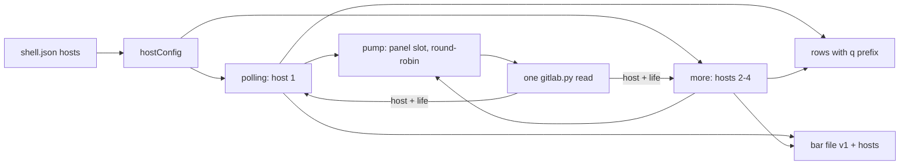

# Plan: Show more than one GitLab host at once

Work in the worktree `/mnt/code/Source-home/GitHub/nixarchy-gltui-42`,
branch `feat/42-multi-host`. Line numbers are from `main` at `c71049a`;
they shift as steps land, so anchor by function name. Codex and agy write
the code (owner's choice); the lead runs every build and VM check,
dispatches the reviews (Codex, agy and an Opus review) and makes every
commit.

## Decisions (from the approved spec)

1. **Config.** Both the panel and `gitlab.py` read the **first**
   `plugins[]` entry with id `olafkfreund.gitlab-pipelines`. `hosts`
   absent or `[]` means today's single-host keys (`host`, `actions`,
   `projects`, `pinned`). A non-empty `hosts` array replaces them. Rules
   in order: (1) every item must be an object whose `host` is a string
   matching `^[A-Za-z0-9][A-Za-z0-9.-]*(:[0-9]{1,5})?$`, else config error
   (also when `hosts` is not an array); (2) drop duplicates compared
   case-insensitively on the whole host incl. port, keep the first;
   (3) keep the first 4, report the rest as `ignored`. `actions` is on
   only if exactly `true`; `projects`/`pinned` per item as today. In the
   single-host form, `host` defaults to `gitlab.com` only when it is
   absent or not a string; `""` is today's `invalid host` error.
2. **A config error** stops all reads (`pump`) and actions (`sendAction`),
   drops a pending action, is never overwritten by a polling error in
   `adopt()`, makes `actions_enabled` false for every host, and the bar
   shows stopped. Ignored hosts are logged once per distinct ignored list
   and named in a notice ("Ignored hosts: a, b; at most 4 are shown") at
   the next `open()`.
3. **Pollers.** Host 1's state stays in `polling` (with `hostLife`).
   Hosts 2-4 are in `more: [{host, life, state}]`. `life` comes from a
   panel-wide counter that only grows. `Polling.js` stays single-host. A
   new poller added while the panel is open is opened (`Polling.open`)
   and gets the current view (`Polling.view`). When host 1 is removed or
   the list is reordered, the new first host's state **and life** move
   into `polling`/`hostLife` unchanged. Any change to a `more[i].state`
   reassigns `more` itself (a new array) so bindings update.
   `watching` becomes true when any host has a watch.
4. **Scheduling.** One host: `pump()` calls `Polling.next` exactly as
   today. Several hosts: the panel keeps a slot with today's pattern
   (`interactive ×3, active, background`) and fallback order, advanced
   only when a request is dispatched. It asks each host
   `Polling.choose(s, now, order)` and takes the earliest group any host
   offers. Among the hosts offering that group it picks round-robin with
   **one cursor per group** (`lastServed[group]`), starting after the
   host that group served last, then calls `Polling.commit` on it only.
   (Refines the spec's single round-robin, which Codex showed can starve
   a third host: with A always interactive, B and C now alternate in the
   background slot.) `choose` keeps `next`'s side effects before the
   pick, including pruning old `starts`; only `commit` advances `slot`,
   appends to `starts`, and sets `requests`, `serial`, `lastRequest`,
   `lastStarted`, `flight`. After the `choose` round, drain every host's
   events.
5. **Replies** carry `host` and `life` in `requestInfo`; a reply for a
   poller that no longer exists is dropped (`workerBusy` cleared). A
   `requestInfo` without `host` means host 1, without checking `life`
   (existing smoke fixtures build requests with `Polling.next`).
6. **Keys.** `q = host + "|"` with several hosts, else `""`. `repoKey =
   "repo:" + q + path`, `runKey = q + path + ":" + runId`; details,
   watched and pinned lookups use `q + path` (+ `":" + runId`). MR keys
   `"mr:" + q + projectId + "!" + iid`; per-host "more" row key
   `"mr:more:" + host`. One host: every key is today's.
7. **Rows** carry `host` (always the real host), raw `repo`, `run`, `job`
   and, on MR rows, `mrKey`. Nothing slices ids out of keys. With several
   hosts: a dimmed host label on repo and MR rows, host in search
   (`repoMatches`, MR search text), and "on <host>" in the accessible name
   of **every** row (repo, run, stage, job, trigger, message, MR, more).
   Raw lookups (`rawJob`, the run for an action, MR status, `jumpMr`'s
   project-id search) use the row's own host's state and repos only.
8. **Selection** goes to the current row's host with raw ids and a local
   expansion map (`shown` keys starting `host + "|"`, prefix removed);
   every other host gets `Polling.select(s, "", "", local)`.
9. **Host-count change** (1 ↔ several) clears `expanded`,
   `searchCollapsed`, `viewState` and the cursor; data stays. Removing one
   of several hosts prunes its keys, ends its watches (event `removed`),
   drops its unsent action, discards its state, and saves `starts`,
   `lastStarted`, `writeAt` in `hostBudget[host]` for 60 s; re-adding
   restores them. Replacing the single host by another keeps today's
   behaviour exactly (`resetHost`, `hostEpoch`, the `host` event).
10. **Pins** per host in `pinState[host] = {config, saved, loaded,
    loadFailed}`; loads one host at a time, capture host + life;
    `sessionPins` (already per host) survives removal; a failed load blocks
    that host's saves until a retry succeeds; saves stay serialized; cap
    10 per host; `pinned.json` unchanged.
11. **Watches**: `Polling.watch(s, repo, run, now, others)` applies the
    cap to `others + own` where it checks the cap today (5 across the
    panel; unwatch/missing/finished keep precedence).
12. **Actions** per host (`actionsFor(host)`); confirmation records host
    and life; `sendAction` and `finishAction` use that poller (cooldown,
    `lastStarted`, `writeAt`, refresh); a result for a gone poller still
    shows its notice ("on <host>:" prefix as today) and applies nothing
    else; with several hosts `describe` appends "on <host>", so a
    successful result adds no second prefix, while a failure (`r.error`,
    which has no host) is prefixed "on <host>:" with several hosts.
    Pending confirmations are dropped in `configure()` when their own
    host loses actions or goes away, not through host 1's
    `onActionsOnChanged`. Actions keep today's exception (separate
    process, alongside a read).
13. **Links** compare the URL authority case-insensitively with the
    row's host, port exact. Traces use `current.host`.
14. **Open filter**: `Model.openFilter(payload, hostOrHosts)` accepts a
    string (today) or a list. Hostname match (case-insensitive, port
    ignored): one match → `{filter, host}`; several hosts sharing the
    hostname → `host: ""`; none → notice "Repository is on X; this panel
    shows Y, Z"; no payload host → all hosts. With several hosts the panel
    sets `openHost` (applied in rows and autoOpen before text matching)
    under a guard so `onFilterTextChanged` does not clear it; cleared by a
    user edit or a later unmatched open; saved with the projects view.
15. **Notices** name the host with several hosts (`watchNotice`,
    `watchMessage`; auth body "Run glab auth login --hostname <host>.").
    New event `removed` (the removed host is passed explicitly, also on a
    two-to-one change): summary "Stopped watching N pipelines" (singular
    for 1), body "N watches on <host> ended: the host was removed." (the
    spec's text).
16. **Errors**: one strip line per stopped or paused host (paused from
    `cooldown`), host-prefixed with several hosts, `maximumLineCount` =
    host count + 1. A host with no repos at all (configured `projects` and
    pins count as repos) shows only its line; a host that fails later
    keeps its cached rows. With several hosts the empty label does not
    repeat the strip's errors. Header "N projects on K hosts". The
    `discoveryComplete`, `cooldownText` and `errorHintText` bindings
    aggregate over hosts (discovery: every host complete or stopped;
    pause: any host paused).
17. **`status()`**: one host → exactly today's object. Several: the
    panel-wide fields stay; `discoveryComplete` = every host complete or
    stopped; `error` = first host error, prefixed; `requests`, `mrs`
    summed; `cooldown`, `lastStarted`, `updated` the latest;
    `lastRequest` of the latest start; `actionsOn` any; plus `hosts:
    [{host, discoveryComplete, error, requests, cooldown, lastRequest,
    lastStarted, actionsOn, mrs}]`.
18. **Bar file**: one host → byte-identical. Several: `version: 1`, all
    current fields, plus `hosts: [{host, state, running, failed, countsAt,
    cooldownUntil, reason}]` (today's rules per host). Top level:
    `running`/`failed` sum hosts in `ok`/`rate` with counts; `state` =
    `stopped` on config error, else `ok` if any ok, else `rate` if any
    paused, else `stopped` if any stopped, else `none`; `cooldownUntil` =
    latest pause deadline when `rate`, else 0; `countsAt` oldest counted;
    `host` = first host + " +N"; `reason` = first stopped host's reason
    prefixed with its host. `onDestruction` writes `none` without `hosts`.
19. **Widget**: with more than one `hosts` entry, re-derive each host's
    state (expired `rate` → `ok` if it has `countsAt`, else `none`), add
    one tooltip line per host in every state, recheck at the earliest
    future per-host deadline. A top-level `none` keeps today's `none`
    look (glyph only, `dimmed: true`, `active: false`, first tooltip line
    "Open GitLab Pipelines to load") and only gains the host lines.
20. **Rollout**: p620 and razer after release through the usual pin
    chain; p510 untouched.

## Steps

1. **Scheduler** — `Polling.js`, `tests/polling.cjs`.
   - Split `next` (lines 269-298) into `choose(s, now, order)` and
     `commit(s, t, now)`. `choose` does the guards, `settle`, the `starts`
     pruning, `seed`/`seedWatches` and the due sort, and returns the
     first due task found by walking `order` (an array of group names)
     then today's fallback `["interactive","active","pinned","background"]`,
     or `null`. `commit` does the rest of today's `next` (slot, appending
     to `starts`, requests, lastStarted, lastRequest, the request object,
     flight) and returns the request. Add `orderFor(slot)`, returning
     today's order for a slot; `next(s, now)` = `choose(s, now,
     orderFor(s.slot))` then `commit`. Plain top-level functions: the file
     is loaded by QML `import` and by `vm` in the tests, so no `export`
     and no `module.exports`.
   - `watch(s, repo, run, now, others)`: the cap line becomes
     `if ((others || 0) + Object.keys(s.watches).length >= WATCH_CAP)`.
   - Tests: existing cases unchanged; for an explicit order with tasks in
     several groups, `choose` returns the expected task; `choose` prunes an
     expired `starts` entry but does not append one, and leaves `slot`,
     `requests`, `serial`, `flight` unchanged, while `commit` appends one
     start and advances them; with one existing watch and `others: 4`,
     `watch` refuses a second with `cap`, still unwatches the existing one,
     and still says `finished` for a finished run.
   - Verify: `node tests/polling.cjs`.
   - Traps: `next` must stay behaviourally identical for one host; `choose`
     must not advance `s.slot`.

2. **Host config** — `PipelinesModel.js`, `gitlab.py`, new
   `tests/host-config.json`, `tests/model.cjs`, `tests/test_gitlab.py`.
   - `Model.hostConfig(entry)` → `{hosts: [{host, actions, projects,
     pinned}], ignored: [], error: ""}` by decision 1. Single-host form:
     `host` is `entry.host` if it is a string (validated; `""` or a bad
     value gives `invalid host X`), else `gitlab.com`. `projects`/`pinned`
     are passed through as arrays (or `[]`), unfiltered; the panel keeps
     filtering them as today.
   - `gitlab.py`: `host_config(entry)` as a Python twin; `actions_enabled(host)`
     reads the first entry with the id, calls `host_config`, returns False
     on error, else whether that host (case-insensitive, whole authority)
     is in `hosts` with `actions is True`.
   - `tests/host-config.json`: cases `[{name, plugins, expect: {hosts,
     ignored, error: bool}, actions: {host: bool}}]` for: no entry, no
     `hosts`, `host: ""`, `host: null`, `hosts: []`, two valid, invalid
     first item, invalid fifth item, `hosts` not an array, duplicates with
     different case, five distinct (fifth ignored, its `actions: true` not
     honoured), `actions: "true"`, a malformed first entry followed by a
     valid second entry (error; second entry not used). Both test files
     load it and compare.
   - Verify: `node tests/model.cjs`; `python3 -m unittest discover -s tests`.
   - Traps: `gitlab.py actions_enabled` today uses `any(...)` over entries;
     change it to the first entry. Never default with `||`/`or` on `host`.

3. **Rows, keys, MR rows, open filter, links** — `PipelinesModel.js`,
   `tests/model.cjs`.
   - `rows(...)` and `autoOpen(...)`: each repo may have `q` and `host`;
     build keys by decision 6 and look up `details[q + path + ":" + id]`,
     `watched[q + path + ":" + id]`, `pinned[q + path]`, including in the
     sort comparator (line 283). Every row gains `host: repo.host || ""`
     and, where they apply, `run` and `job` beside the existing `repo`;
     repo rows get `hostLabel: repo.q ? repo.host : ""`. `repoMatches`
     also matches `repo.host` when `repo.q`. Add an optional last argument
     `openHost` to `rows` and `autoOpen`: when set, repos with another host
     are skipped before matching.
   - `accessibleName(row)` appends " on " + `row.host` when the row's key
     starts with a host prefix (every row kind; pass a `multi` flag or
     read `row.hostLabel || row.multi`; keep one-host names unchanged).
   - `mrRows(mrs, filter, now, host, selectedKey, q)`: with `q`, keys
     `"mr:" + q + key`, `hostLabel`, host in the search text and
     accessible name, the "more" row key `"mr:more:" + host`, title
     suffix " · " + host. Every MR row gets `mrKey: key` and `host`.
   - `openFilter(payload, hosts)`: `hosts` may be a string (today's
     callers; return exactly today's `{filter, notice}` objects) or an
     array of strings (return `{filter, host, notice}` by decision 14).
   - `browsable(url, host)`: case-insensitive match of the authority,
     port exact.
   - `syncRows` only rewrites a row when a field in `shownFields` (line
     386) changes: add `hostLabel` and `host` to it, and test that a row
     with the same key but another `host` is updated.
   - Tests: one-host `rows`/`mrRows`/`autoOpen` output equal to today's
     except the new `host`/`run`/`job`/`mrKey` fields; two hosts with the
     same path, pipeline 7 and MR `1!1` give distinct keys, labels and
     accessible names (repo, run and job rows); pinned sorting with `q`;
     `openHost` filtering; per-host "more" rows; `openFilter` string
     (today's results), list (match, port ambiguity, no match, hostless);
     `browsable` casing and ports; the `syncRows` case.
   - Verify: `node tests/model.cjs`.
   - Traps: `Model.merge` and `selection` stay untouched (opaque keys).

4. **Host texts and bar status** — `PipelinesModel.js`, `tests/model.cjs`.
   - `describe(action, repo, run, job, host)`: when `host` is given,
     append " on " + host to the description used in both `confirm`
     (before "?") and `done`.
   - `watchNotice(code, repo, number, host)`: when `host`, the watching
     and unwatched texts end with " on " + host.
   - `watchText(event, oldHost, newHost, host)` (and `watchMessage`):
     when `host`, the finished/expired/unavailable bodies end with
     " on " + host, the auth body is "Stopped watching N pipelines. Run
     glab auth login --hostname <host>.", and the new `removed` type gives
     the decision 15 texts (summary uses today's `many`). Without `host`,
     every text is today's.
   - `barStatus(polling, configError, host, instance, now, more)`: `more`
     (optional) is `[{host, state}]` for hosts 2-4. Without it, output is
     today's. With it, compute each host's entry with today's rules and
     the top level by decision 18.
   - Tests: every text with and without host; `barStatus` without `more`
     equal to today's; ok+rate, stopped+none, all rate (latest deadline),
     config error, `host` "+N", `reason` prefix.
   - Verify: `node tests/model.cjs`.
   - Traps: never change a text when `host` is absent.

5. **Bar widget** — `bar-widget/BarModel.js`, `tests/bar.cjs`,
   `bar-widget/manifest.json` and `manifest.json` version `1.17.0`.
   - In `view(text, now, vertical)`: if `status.hosts` is an array with
     more than one entry, validate each item like the top level (strings
     cut to 100/120, counts clamped), re-derive each host's state
     (decision 19), and append one line per host ("<host>: ●N ✕M",
     "<host>: paused until HH:MM", "<host>: stopped — <reason>",
     "<host>: no data") to the tooltip in every top state. For top-level
     `none` return today's `none` object with the host lines appended to
     its tooltip and accessible text (decision 19). `recheckAt` = the
     earliest future per-host `cooldownUntil` (top-level rule when there
     are no hosts).
   - Tests: a single-host file gives today's output exactly; multi-host
     tooltip lines in `none` (flags as today), `ok`, `rate`, `stopped`;
     recheck at the earliest host deadline; an expired host pause.
   - Verify: `node tests/bar.cjs`; the lead runs `nix build .#bar
     .#checks.x86_64-linux.plugin --no-link`.
   - Traps: the flake check asserts both manifests carry the same version.

6. **Panel** — `PipelinesPanel.qml` (one step; nothing here works half
   done).
   - Properties: `more: []`, `hostLife`, `lifeSerial`, `panelSlot`,
     `lastServed: ({})`, `hostBudget: ({})`, `hostsList: []`,
     `ignoredHosts: []`, `loggedIgnored: ""`, `openHost: ""`,
     `settingOpen: false`, `pinState: ({})`. Helpers: `pollers()` →
     `[{host, life, state}]` (host 1 from `host`/`hostLife`/`polling`),
     `pollerFor(host, life)`, `setState(i, s)` (host 1 through `polling`,
     others by replacing `more` with a new array), `multi()`, `qOf(host)`,
     `actionsFor(host)`, `stateOf(row)` (the row's host's state).
     `watching` binds to "any poller has a watch".
   - `configure(text)`: use `Model.hostConfig(entry)`. On error: set
     `configError`, drop the pending action, stop. Otherwise apply
     decisions 3 and 9 (host-count reset; removed hosts: `removed` event,
     prune keys, drop their pending action, save `hostBudget`; added hosts:
     new state from `hostBudget`, opened and given the view when the panel
     is open, pins loaded; kept hosts: settings update in place; host 1
     handover keeps state and life). Drop a confirmation whose host lost
     actions. The single host replaced by another runs today's code.
   - `pump()`: return when `configError`. One host: today's code. Several:
     decision 4, then drain every host's events; record
     `requestInfo.host`/`life` and send `request.host`.
   - `receivePage`/`finishRequest`: decision 5.
   - `adopt()`: build `repos` from every host's repos tagged with `host`
     and `q`; merge `details`, `watched` (with `q`) and the MR lists; set
     `error` per decision 16 but never replace `configError`; compare the
     current row with **its own host's** `selected`/`inspected`/
     `mrSelected` before calling `selectionChanged(false)`.
   - `selectionChanged`, `refresh`, `open`, `close`, `switchView`,
     `jumpMr`: decisions 8 and 4 (open/close/view/manual on every host;
     `r` the current host, `Shift + R` all). MR selection via
     `current.mrKey`, never `key.slice(3)`. `jumpMr` reads the MR status
     and searches repos by project id in the row's host only, builds
     `q`-prefixed keys for `expanded`/`switchView` and passes the local
     map to `Polling.jump`; it clears `openHost`.
   - `rebuild`: pass the merged inputs and `openHost`; for the MR view
     concatenate each host's `Model.mrRows(..., qOf(h))`.
   - Pins: `pinState` by decision 10, replacing `configPins`, `savedPins`,
     `pinsLoaded`, `pinsLoadFailed`, `pinsLoadHost`; `applyPins` builds the
     `q`-keyed `pinned` map; `togglePin` uses `current.host`.
   - Watches: `toggleWatch` calls `Polling.watch` on the row's host with
     `others` and, with several hosts, passes the host to `watchNotice`.
   - Actions: decision 12. `startAction` checks `current` first, then
     uses `stateOf(current)` for the run, `rawJob`, cooldown and
     eligibility; `listHint` and the actions-off hint follow
     `actionsFor(current ? current.host : host)`; `actionsOn` stays a
     property equal to host 1's setting.
   - Traces: `current.host`. Links: `Model.browsable(url, row.host)`.
   - Notices: `drainEvents` per host with the host (several hosts only);
     the ignored-hosts notice at `open()`.
   - Open: `applyOpen` by decision 14; set `filterText` and `openHost`
     with `settingOpen` true so `onFilterTextChanged` keeps `openHost`;
     when the text is unchanged but the host differs, rebuild explicitly;
     save `openHost` in `viewState.projects` and restore it in
     `switchView`.
   - Errors, header, bindings: decision 16; the delegate shows `hostLabel`
     dimmed after the title; the MR header and empty label sum over hosts.
   - `status()` decision 17; `publishStatus` passes `more` to
     `Model.barStatus`; `onDestruction` decision 18.
   - Verify: `node tests/polling.cjs && node tests/model.cjs && node
     tests/bar.cjs`; the lead's VM smoke after step 7.
   - Traps: with one host every text, key and `status()` field stays
     today's. `adopt()` reassigns `polling = Object.assign({}, polling)`;
     do the equivalent for `more`. The `filterText` alias fires
     `onFilterTextChanged` synchronously. Keep `hostEpoch` for the
     single-host path. Never run quickshell or the smoke here.

7. **Smoke** — `tests/qml-smoke.py`.
   - Update the fixtures that set or read the removed pin scalars, keeping
     every assertion's meaning.
   - The fake helper keeps today's answers. Only while a new flag file
     `MULTI` exists does `gitlab.other.org` serve the same catalogue as
     `gitlab.example.org` (`one/sub/repo` id 1 with pipeline 7,
     `two/repo`), the same MR `1!1`, and URLs on its own host; a second
     flag `OTHER_DELAY` delays only `gitlab.other.org` replies and marks
     them (for example a different pipeline name) so a late reply is
     recognisable; every request's host is appended to `HOST_LOG`.
   - New stage "multihost", reached by both the widget and the
     no-widget path before the success marker: configure both hosts;
     rows and labels; expand pipeline 7 on host 2 and see jobs load with
     requests logged for host 2; an MR jump on host 2 with the duplicate
     project id; pin on host 2 only; an action confirmed on host 2 sent
     with host 2 (action log); job eligibility read from host 2 when the
     same job id differs; host 2 replying auth error while host 1 keeps
     updating and the strip names host 2; with `OTHER_DELAY`, remove host
     2 while its read is in flight, re-add it at once, and check the
     marked late reply is not applied; adding host 2 while open in the MR
     view loads its MRs; removing host 1 keeps host 2's rows; a host-2-only
     watch keeps polling after close; the 1 → 2 host reset; two opens with
     the same filter text and different hosts; unwatch at the cap; the
     status file totals and `hosts`.
   - Verify (lead): `nix build ./ci#checks.x86_64-linux.qml-smoke -L
     --no-link --override-input gltui path:/mnt/code/Source-home/GitHub/nixarchy-gltui-42`.
   - Traps: `eq()` compares with `===` and builds its failure message
     with `JSON.stringify`, so never pass QML objects; millisecond times
     need `property double`; `adopt()` replaces `polling` with a copy, so
     re-read it after waits; FileView caches text, reload before reading;
     the global timer is 180 s per scenario. Never run the smoke outside
     the VM check.

8. **Docs** — `README.md`.
   - Replace "One host is shown at a time" with a "Several hosts"
     section: the `hosts` config and precedence over the top-level keys,
     the 4-host cap, per-host actions/projects/pinned, the shared read
     slot and per-host limits, the slow-host delay, `r` vs `Shift + R`,
     repository open, the 1 ↔ several reset, the bar widget totals and
     tooltip, and that `glab` may send an environment token to every
     configured host.
   - Verify: lead reads the diff.

## Tests

- `node tests/polling.cjs`, `node tests/model.cjs`, `node tests/bar.cjs`:
  all pass (run each; `node tests/*.cjs` runs only the first).
- `python3 -m unittest discover -s tests`: all pass.
- `nix build .#bar .#checks.x86_64-linux.plugin --no-link`: OK. This
  check runs `menu.py` and the smoke script's invalid-directory path
  inside the build sandbox; that is not a graphical run.
- VM smoke (step 7 command): `QML_CHECKS_PASSED` in both scenarios.
- CI on the PR: `flake` and `qml-smoke` pass.

## Deviations

None yet.

## Rollback

Revert the squash commit and release a patch; the pin chain (nixarchy,
nixos_config) moves back to `c71049a`. A user's `hosts` entry is then
ignored and the top-level `host` applies again.
