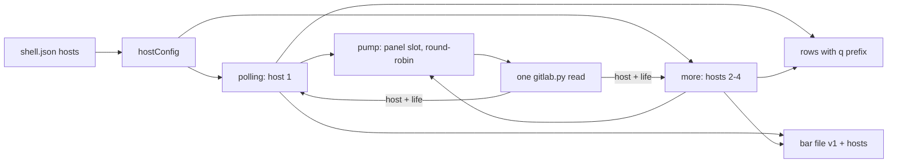

# Plan: Show more than one GitLab host at once

Work in the worktree `/mnt/code/Source-home/GitHub/nixarchy-gltui-42`,
branch `feat/42-multi-host`. Line numbers are from `main` at `c71049a`;
they shift as steps land, so anchor by function name. Codex and agy write
the code (owner's choice); the lead runs every build and VM check,
dispatches the reviews (Codex, agy and an Opus review) and makes every
commit.

## Decisions (from the approved spec)

1. **Config.** Both the panel and `gitlab.py` read the **first**
   `plugins[]` entry with id `olafkfreund.gitlab-pipelines`. `hosts`
   absent or `[]` means today's single-host keys (`host`, `actions`,
   `projects`, `pinned`). A non-empty `hosts` array replaces them. Rules
   in order: (1) every item must be an object whose `host` is a string
   matching `^[A-Za-z0-9][A-Za-z0-9.-]*(:[0-9]{1,5})?$`, else config error
   (also when `hosts` is not an array); (2) drop duplicates compared
   case-insensitively on the whole host incl. port, keep the first;
   (3) keep the first 4, report the rest as `ignored`. `actions` is on
   only if exactly `true`; `projects`/`pinned` per item as today.
2. **A config error** stops all reads (`pump`) and actions (`sendAction`),
   drops a pending action, is never overwritten by a polling error in
   `adopt()`, makes `actions_enabled` false for every host, and the bar
   shows stopped. Ignored hosts are logged and named in a notice
   ("Ignored hosts: a, b; at most 4 are shown") at the next `open()`.
3. **Pollers.** Host 1's state stays in `polling`. Hosts 2-4 are in
   `more: [{host, life, state}]`. `life` comes from a panel-wide counter
   that only grows. `Polling.js` stays single-host.
4. **Scheduling.** One host: `pump()` calls `Polling.next` exactly as
   today. Several hosts: the panel keeps a slot with today's pattern
   (`interactive ×3, active, background`) and fallback order; it asks each
   host `Polling.choose(s, now, order)`, takes the host (round-robin from
   the one after the host served last) whose best task is in the
   earliest group, and calls `Polling.commit` on it only. `choose` keeps
   `next`'s side effects before the pick; only `commit` advances `slot`,
   `starts`, `requests`, `serial`, `lastRequest`, `lastStarted`, `flight`.
   After the `choose` round, drain every host's events.
5. **Replies** carry `host` and `life` in `requestInfo`; a reply for a
   poller that no longer exists is dropped (`workerBusy` cleared). A
   `requestInfo` without `host` means host 1.
6. **Keys.** `q = host + "|"` with several hosts, else `""`. `repoKey =
   "repo:" + q + path`, `runKey = q + path + ":" + runId`; details,
   watched and pinned lookups use `q + path` (+ `":" + runId`). MR keys
   `"mr:" + q + projectId + "!" + iid`; per-host "more" row key
   `"mr:more:" + host`. One host: every key is today's.
7. **Rows** carry `host` (always the real host), raw `repo`, `run`, `job`
   and, on MR rows, `mrKey`. Nothing slices ids out of keys. With several
   hosts: a dimmed host label, host in search (`repoMatches`, MR search
   text), "on <host>" in accessible names.
8. **Selection** goes to the current row's host with raw ids and a local
   expansion map (`shown` keys starting `host + "|"`, prefix removed);
   every other host gets `Polling.select(s, "", "", local)`.
9. **Host-count change** (1 ↔ several) clears `expanded`,
   `searchCollapsed`, `viewState` and the cursor; data stays. Removing one
   of several hosts prunes its keys, ends its watches (event `removed`),
   drops its unsent action, discards its state, and saves `starts`,
   `lastStarted`, `writeAt` in `hostBudget[host]` for 60 s; re-adding
   restores them. Replacing the single host by another keeps today's
   behaviour exactly (`resetHost`, `hostEpoch`, the `host` event).
10. **Pins** per host in `pinState[host] = {config, saved, loaded,
    loadFailed}`; loads one host at a time, capture host + life;
    `sessionPins` (already per host) survives removal; a failed load blocks
    that host's saves until a retry succeeds; saves stay serialized; cap
    10 per host; `pinned.json` unchanged.
11. **Watches**: `Polling.watch(s, repo, run, now, others)` applies the
    cap to `others + own` where it checks the cap today (5 across the
    panel; unwatch/missing/finished keep precedence).
12. **Actions** per host (`actionsFor(host)`); confirmation records host
    and life; `sendAction` and `finishAction` use that poller (cooldown,
    `lastStarted`, `writeAt`, refresh); a result for a gone poller still
    shows its notice ("on <host>:" prefix as today) and applies nothing
    else; with several hosts `describe` appends "on <host>" and
    `finishAction` adds no second prefix. Actions keep today's exception
    (separate process, alongside a read).
13. **Links** compare the URL authority case-insensitively with the
    row's host, port exact. Traces use `current.host`.
14. **Open filter**: `Model.openFilter(payload, hostOrHosts)` accepts a
    string (today) or a list. Hostname match (case-insensitive, port
    ignored): one match → `{filter, host}`; several hosts sharing the
    hostname → `host: ""`; none → notice "Repository is on X; this panel
    shows Y, Z"; no payload host → all hosts. With several hosts the panel
    sets `openHost` (applied in rows and autoOpen before text matching)
    under a guard so `onFilterTextChanged` does not clear it; cleared by a
    user edit or a later unmatched open; saved with the projects view.
15. **Notices** name the host with several hosts (`watchNotice`,
    `watchMessage`; auth body "Run glab auth login --hostname <host>.").
    New event `removed`: summary "Stopped watching N pipelines", body
    "<host> was removed from the panel." 
16. **Errors**: one strip line per stopped or paused host (paused from
    `cooldown`), host-prefixed with several hosts, `maximumLineCount` =
    host count + 1. A host with no repos at all shows only its line.
    Header "N projects on K hosts".
17. **`status()`**: one host → exactly today's object. Several: the
    panel-wide fields stay; `discoveryComplete` = every host complete or
    stopped; `error` = first host error, prefixed; `requests`, `mrs`
    summed; `cooldown`, `lastStarted`, `updated` the latest;
    `lastRequest` of the latest start; `actionsOn` any; plus `hosts:
    [{host, discoveryComplete, error, requests, cooldown, lastRequest,
    lastStarted, actionsOn, mrs}]`.
18. **Bar file**: one host → byte-identical. Several: `version: 1`, all
    current fields, plus `hosts: [{host, state, running, failed, countsAt,
    cooldownUntil, reason}]` (today's rules per host). Top level:
    `running`/`failed` sum hosts in `ok`/`rate` with counts; `state` =
    `stopped` on config error, else `ok` if any ok, else `rate` if any
    paused, else `stopped` if any stopped, else `none`; `cooldownUntil` =
    latest pause deadline when `rate`, else 0; `countsAt` oldest counted;
    `host` = first host + " +N"; `reason` = first stopped host's reason
    prefixed with its host. `onDestruction` writes `none` without `hosts`.
19. **Widget**: with more than one `hosts` entry, re-derive each host's
    state (expired `rate` → `ok` if it has `countsAt`, else `none`), add
    one tooltip line per host in every state, recheck at the earliest
    future per-host deadline.

## Steps

1. **Scheduler** — `Polling.js`, `tests/polling.cjs`.
   - Split `next` (lines 269-298) into `choose(s, now, order)` and
     `commit(s, t, now)`. `choose` does the guards, `settle`, `starts`
     pruning, `seed`/`seedWatches` and the due sort, and returns the
     first due task found by walking `order` (an array of group names)
     then today's fallback `["interactive","active","pinned","background"]`,
     or `null`. `commit` does the rest of today's `next` (slot, starts,
     requests, lastStarted, lastRequest, request object, flight) and
     returns the request. Add `orderFor(slot)`, returning today's order
     for a slot; `next(s, now)` = `choose(s, now, orderFor(s.slot))` then
     `commit`. Export `orderFor`, `choose`, `commit`.
   - `watch(s, repo, run, now, others)`: the cap line becomes
     `if ((others || 0) + Object.keys(s.watches).length >= WATCH_CAP)`.
   - Tests: existing cases unchanged; `next` equals `choose`+`commit` on a
     seeded state; `choose` alone leaves `slot`, `starts`, `requests`,
     `serial`, `flight` unchanged; `watch` with `others: 4` refuses a new
     watch with `cap` but still unwatches an existing one and still says
     `finished` for a finished run.
   - Verify: `node tests/polling.cjs`.
   - Traps: `next` must stay byte-identical for one host; `choose` must
     not advance `s.slot`.

2. **Host config** — `PipelinesModel.js`, `gitlab.py`, new
   `tests/host-config.json`, `tests/model.cjs`, `tests/test_gitlab.py`.
   - `Model.hostConfig(entry)` → `{hosts: [{host, actions, projects,
     pinned}], ignored: [], error: ""}` by decision 1 (single-host form:
     one host from `entry.host` or `gitlab.com`, validated with the same
     pattern; an invalid `host` gives today's error text `invalid host X`).
     `projects`/`pinned` are passed through as arrays (or `[]`), unfiltered;
     the panel keeps filtering them as today.
   - `gitlab.py`: `host_config(entry)` as a Python twin; `actions_enabled(host)`
     reads the first entry with the id, calls `host_config`, returns False
     on error, else whether that host (case-insensitive, whole authority)
     is in `hosts` with `actions is True`.
   - `tests/host-config.json`: cases `[{name, plugins, expect: {hosts,
     ignored, error: bool}, actions: {host: bool}}]` for: no entry, no
     `hosts`, `hosts: []`, two valid, invalid first item, invalid fifth
     item, `hosts` not an array, duplicates with different case, five
     distinct (fifth ignored, its `actions: true` not honoured),
     `actions: "true"`, a malformed first entry followed by a valid second
     entry (error; second entry not used). Both test files load it and
     compare.
   - Verify: `node tests/model.cjs`; `python3 -m unittest discover -s tests`.
   - Traps: `gitlab.py actions_enabled` today uses `any(...)` over entries;
     change it to the first entry. Python `True` vs JS `true` only.

3. **Rows, keys, MR rows, open filter, links** — `PipelinesModel.js`,
   `tests/model.cjs`.
   - `rows(...)` and `autoOpen(...)`: each repo may have `q` and `host`;
     build keys by decision 6 and look up `details[q + path + ":" + id]`,
     `watched[q + path + ":" + id]`, `pinned[q + path]`. Every row gains
     `host: repo.host || ""`, `run`, `job` (where a run/job applies) beside
     the existing `repo`. A repo row gets `hostLabel: repo.q ? repo.host :
     ""`. `repoMatches(repo, query)` also matches `repo.host` when `repo.q`.
     Add an `openHost` argument (last, optional) to `rows` and `autoOpen`:
     when set, repos with another host are skipped before matching.
   - `accessibleName(row)` appends " on " + host when `row.hostLabel`.
   - `mrRows(mrs, filter, now, host, selectedKey, q)`: with `q`, keys
     `"mr:" + q + key`, `hostLabel`, host in the search text and
     accessible name, the "more" row key `"mr:more:" + host`, title
     suffix " · " + host. Every MR row gets `mrKey: key` and `host`.
   - `openFilter(payload, hosts)`: `hosts` may be a string or an array of
     strings; return `{filter, host, notice}` by decision 14; with a
     string, results equal today's plus `host`.
   - `browsable(url, host)`: case-insensitive match of the authority,
     port exact.
   - Tests: one-host `rows`/`mrRows`/`autoOpen` output deep-equal to
     today's except the new `host`/`run`/`job`/`mrKey` fields; two hosts
     with the same path, pipeline id 7 and MR `1!1` give distinct keys,
     labels and names; `openHost` filtering; per-host "more" rows;
     `openFilter` string/list/port ambiguity/no match/hostless;
     `browsable` casing and ports.
   - Verify: `node tests/model.cjs`.
   - Traps: `Model.merge`, `selection`, `syncRows` stay untouched (opaque
     keys). `syncRows` copies row fields: check it copies the new ones.

4. **Host texts and bar status** — `PipelinesModel.js`, `tests/model.cjs`.
   - `describe(action, repo, run, job, host)`: when `host` is given,
     append " on " + host to both `confirm` (before "?") and `done`.
   - `watchNotice(code, repo, number, host)`: when `host`, the watching
     and unwatched texts end with " on " + host.
   - `watchText(event, oldHost, newHost, host)` (and `watchMessage`):
     when `host`, the finished/expired/unavailable bodies end with
     " on " + host, the auth body is "Stopped watching N pipelines. Run
     glab auth login --hostname <host>.", and a new `removed` type gives
     summary "Stopped watching N pipelines", body "<host> was removed
     from the panel.". Without `host`, all texts are today's.
   - `barStatus(polling, configError, host, instance, now, more)`: `more`
     (optional) is `[{host, state}]` for hosts 2-4. Without it, output is
     today's. With it, compute each host's entry with today's rules and
     the top level by decision 18.
   - Tests: every text with and without host; `barStatus` without `more`
     deep-equals today's; ok+rate, stopped+none, all rate (latest
     deadline), config error, `host` "+N", `reason` prefix.
   - Verify: `node tests/model.cjs`.
   - Traps: never change a text when `host` is absent.

5. **Bar widget** — `bar-widget/BarModel.js`, `tests/bar.cjs`,
   `bar-widget/manifest.json` and `manifest.json` version `1.17.0`.
   - In `view(text, now, vertical)`: if `status.hosts` is an array with
     more than one entry, validate each item like the top level (strings
     cut to 100/120, counts clamped), re-derive each host's state
     (decision 19), and append one line per host
     ("<host>: ok · ●N ✕M", "<host>: paused until HH:MM", "<host>:
     stopped — <reason>", "<host>: no data") to the tooltip in every top
     state, including `none` (so do not return the bare `none` object
     early in that case). `recheckAt` = the earliest future per-host
     `cooldownUntil` (or the top-level rule when there are no hosts).
   - Tests: a single-host file gives today's output exactly; multi-host
     tooltip lines in `none`, `ok`, `rate`, `stopped`; recheck at the
     earliest host deadline; a host pause that has expired.
   - Verify: `node tests/bar.cjs`; `nix build .#bar
     .#checks.x86_64-linux.plugin --no-link` (lead).
   - Traps: the flake check asserts both manifests carry the same version.

6. **Panel core** — `PipelinesPanel.qml`.
   - Properties: `more: []`, `lifeSerial`, `lastServed`, `panelSlot`,
     `hostBudget: ({})`, `hostsList: []` (configured hosts in order),
     `ignoredHosts: []`. Helpers: `pollers()` → `[{host, life, state}]`
     (host 1 from `host`/`hostLife`/`polling`), `pollerFor(host, life)`,
     `setState(i, s)`, `multi()` (more than one host), `qOf(host)`.
   - `configure(text)`: use `Model.hostConfig(entry)`. On error: set
     `configError`, drop the pending action, stop. Otherwise apply
     decision 9 (host-count change resets, removed hosts, added hosts with
     `hostBudget`, kept hosts update settings). The one-host-replaced case
     runs today's code unchanged.
   - `pump()`: return when `configError`. One host: today's code. Several:
     decision 4, then drain every host's events; send `request.host` and
     record `requestInfo.host`/`life`.
   - `receivePage`/`finishRequest`: route by decision 5.
   - `adopt()`: build `repos` from every host's repos tagged with `host`
     and `q`; merge `details` and `watched` with `q` prefixes; `error` per
     decision 16 but never replace `configError`.
   - `selectionChanged`, `jumpMr`, `refresh`, `open`, `close`,
     `switchView`: decisions 8 and 4 (open/close/view/manual on every
     host; `r` the current host, `Shift + R` all); MR selection via
     `current.mrKey`, never `key.slice(3)`.
   - `rebuild`: pass the merged inputs, `openHost`, and for the MR view
     concatenate each host's `Model.mrRows(..., qOf(h))`.
   - Verify: `node tests/*.cjs`; the VM smoke run by the lead after step 8.
   - Traps: `adopt()` reassigns `polling = Object.assign({}, polling)`;
     do the same for each `more[i].state` so bindings update. Keep
     `hostEpoch` for the single-host path. Never call quickshell here.

7. **Panel features** — `PipelinesPanel.qml`.
   - Pins: `pinState` per decision 10, replacing `configPins`,
     `savedPins`, `pinsLoaded`, `pinsLoadFailed`, `pinsLoadHost`;
     `applyPins` builds the `q`-keyed `pinned` map; `togglePin` uses
     `current.host`.
   - Watches: `toggleWatch` passes `others` (watches on other hosts) and,
     with several hosts, the host to `watchNotice`.
   - Actions: decision 12; `startAction` checks `current` first;
     `listHint` and the actions-off hint follow `actionsFor(current.host)`;
     keep `actionsOn` as a property equal to host 1's setting for one host.
   - Traces: `current.host`. Links: `Model.browsable(url, row.host)`.
   - Notices: `drainEvents` per host with the host (several hosts only);
     the `removed` event; the ignored-hosts notice at `open()`.
   - Open: `applyOpen` with decision 14 and the `openHost` guard in
     `onFilterTextChanged`; `viewState.projects.openHost`.
   - Errors and header: decision 16; delegate shows `hostLabel` dimmed
     after the title; MR header and empty label sum over hosts.
   - `status()` decision 17; `publishStatus` passes `more` to
     `Model.barStatus`; `onDestruction` decision 18.
   - Verify: as step 6.
   - Traps: with one host every text, key and `status()` field must stay
     today's. The `filterText` alias fires `onFilterTextChanged`
     synchronously.

8. **Smoke** — `tests/qml-smoke.py`.
   - Update fixtures that set or read the removed pin scalars or
     `actionsOn`, keeping every assertion's meaning.
   - The fake helper: `gitlab.other.org` serves the same catalogue as
     `gitlab.example.org` (`one/sub/repo` id 1 with pipeline 7, `two/repo`)
     and the same MR `1!1`, except where a stage needs a difference;
     record each request's host to a log (`HOST_LOG`).
   - New stage "multihost": configure both hosts; check rows and labels;
     expand pipeline 7 on host 2 and see jobs load with requests logged
     for host 2; MR jump on host 2; pin on host 2 only; an action
     confirmed on host 2 is sent with host 2 (action log); make host 2
     reply auth error and check host 1 keeps updating and the strip names
     host 2; remove host 2 while its read is in flight (late reply
     ignored) and re-add it; the 1 → 2 host reset; unwatch at the cap;
     the status file totals and `hosts`.
   - Verify (lead): `nix build ./ci#checks.x86_64-linux.qml-smoke -L
     --no-link --override-input gltui path:/mnt/code/Source-home/GitHub/nixarchy-gltui-42`.
   - Traps: `eq()` stringifies its value: never pass QML objects; millisecond
     times need `property double`; `adopt()` replaces `polling` with a copy,
     so re-read it after waits; FileView caches text, reload before
     reading; the global timer is 180 s per scenario. Never run the smoke
     outside the VM check.

9. **Docs** — `README.md`.
   - Replace "One host is shown at a time" with a "Several hosts"
     section: the `hosts` config and precedence over the top-level keys,
     the 4-host cap, per-host actions/projects/pinned, the shared read
     slot and per-host limits, the slow-host delay, `r` vs `Shift + R`,
     repository open, the 1 ↔ several reset, the bar widget totals and
     tooltip, and that `glab` may send an environment token to every
     configured host.
   - Verify: lead reads the diff.

## Tests

- `node tests/polling.cjs`, `node tests/model.cjs`, `node tests/bar.cjs`:
  all pass.
- `python3 -m unittest discover -s tests`: all pass.
- `nix build .#bar .#checks.x86_64-linux.plugin --no-link`: OK.
- VM smoke (step 8 command): `QML_CHECKS_PASSED` in both scenarios.
- CI on the PR: `flake` and `qml-smoke` pass.

## Deviations

None yet.

## Rollback

Revert the squash commit and release a patch; the pin chain (nixarchy,
nixos_config) moves back to `c71049a`. A user's `hosts` entry is then
ignored and the top-level `host` applies again.
