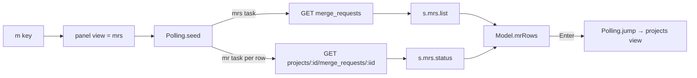

# Spec: A "my merge requests" view

The approved intent's recommendations are taken as decisions: (1) only merge
requests you opened; (2) the first 50 by `updated_at`; (3) `m` toggles the
view; (4) Enter jumps into the pipeline's project when it is in the projects
view; (5) one `head_pipeline` request per merge request, in the shared
budget; (6) the list refreshes on first switch, every 60 s while shown and on
`r`; (7) project polling continues, only the selected-project rates pause;
(8) the view is remembered until the shell restarts.

## Design

### Data flow

### Helper (`gitlab.py`)

Two new read kinds in `page_endpoint` (line 138), both page 1 only:

- **`mrs`**: `merge_requests?scope=created_by_me&state=opened&order_by=updated_at&sort=desc&per_page=50`.
  Global endpoint: it covers every project the token can see, members or not
  (GitLab "List merge requests"). Its documented fields have no pipeline.
- **`mr`**: `projects/<project>/merge_requests/<iid>`, where `project` and
  `iid` are checked with `numeric_id` (line 131). Using the numeric
  `project_id` from the list avoids parsing a path out of `references`.

New parsers, next to `pipeline()` (line 251):

- **`merge_request(row)`** → `{id, iid, project_id, project, title,
  source_branch, draft, web_url, updated_at}`. `id`, `iid` and `project_id`
  must be positive ints, or the row raises `ValueError` (like `entry`).
  `project` is `references.full` without its `!iid` suffix, kept only if
  `project_path()` accepts it, else `""` (display falls back to the web URL's
  path, never to raw text). `title` and `source_branch` go through `plain()`
  (#15). `draft` is `bool(row.get("draft") or row.get("work_in_progress"))`.
- **`mr_detail(row)`** → `{iid, project_id, pipeline, pipelineState}`:
  - `head_pipeline` key **absent** → `pipelineState: "hidden"`, `pipeline:
    null`. GitLab exposes it only to users who may read the project's
    pipelines (`API::Entities::MergeRequest`, `if: can read_pipeline`).
  - key present and `null` → `"none"`.
  - an object → `"ok"`, `pipeline` = `pipeline(head)` plus `project_id` (the
    pipeline's own project, a positive int, which for a fork can differ from
    the merge request's `project_id`). `pipeline()` already accepts GitLab's
    basic pipeline fields (`id`, `status`, `ref`, `sha`, `source`,
    `updated_at`, `web_url`); missing `started_at` leaves `run_started_at`
    as `created_at`.

`read_page` (line 418) gains the two kinds: `mrs` returns a list plus
`total = pipeline_total(headers, len(body))` (−1 = more, count unknown);
`mr` returns an object and checks that its `iid` matches the task. A 403 or
404 on either is `errorType="permission"` with "Merge request unavailable",
not the project message.

`project()` (line 317) also returns the project's numeric `id`, so the panel
can map a pipeline's `project_id` to a catalogue path.

### Scheduler (`Polling.js`)

State in `create()`: `mrView:false` and `mrs:{list:null, total:0, listAt:undefined,
error:"", status:{}}`, where `status` is keyed `"<project_id>!<iid>"` →
`{state:"ok"|"none"|"hidden"|"unavailable", pipeline, at, mrUpdated}`.
`resetHost` keeps `mrView` and starts `mrs` empty; its generation bump
already drops replies for the old host (`complete`, line 338).

- **`view(s, on, now)`** sets `mrView`, clears `wakeAt`.
- **`seed`** (line 143), only while `opened && mrView`:
  - `mrs` task (group `interactive`) when `now >= age(listAt, 60000)`.
  - per list row, an `mr` task carrying `project` and `iid`:
    - the selected merge request (`s.mrSelected`): group `interactive`,
      every 10 s while its pipeline is unfinished, else on the finished rule;
    - unchecked (no status): group `background`, due now;
    - unfinished pipeline: group `pinned`, every 30 s;
    - finished, `none` or `hidden`: group `background`, every 10 minutes, or
      due now when the list's `updated_at` differs from the status's
      `mrUpdated`.
  - `pinned` sits behind `active` in the existing slot order (line 242), so
    projects with running pipelines keep their 15 s rate; `mr` reads take
    what is left of the 60-a-minute budget, so freshness is best effort.
  - Tasks of kind `mrs`/`mr` are deleted when `mrView` is off, like summary
    tasks for an unselected project. The owner check (`t.repo && !owner`,
    line 152) does not apply: they have no `repo`.
- **`complete`** (line 334): `mrs` replaces `list` (cut to 50), sets
  `total`, `listAt`, `error:""`, and drops statuses of merge requests no
  longer listed. `mr` stores the status with `at:now` and `mrUpdated` from
  the list row. Errors: `rate`, `auth`, `setup` and `network` follow the
  existing paths (cooldown, stop, backoff); `permission` on `mr` stores
  `state:"unavailable"`; on `mrs` it sets `mrs.error` and `listAt=now`, so it
  retries a minute later. No error marks a project blocked. The
  "invalid data" check (line 342) treats `mr` like `run` (an object).
- **`jump(s, repo, run, now)`**: merges the given pipeline into that repo's
  runs (`mergeRuns`) so its row exists at once, then `touch` (line 73)
  fetches it in full.
- **`select`** keeps working: in the merge-request view the panel calls it
  with no repo, so selected-project rates pause (decision 7), and sets
  `s.mrSelected`.

### Model (`PipelinesModel.js`)

- **`mrRows(mrs, filter, now)`** → rows with `kind:"mr"`, `key:"mr:<project_id>!<iid>"`,
  `title` `"<project> !<iid> <title>"` (with `Draft · ` first when draft),
  `subtitle` the source branch, `status` from the pipeline (`state()`), or
  `neutral` with `info` "not checked", "no pipeline", "pipeline hidden" or
  "unavailable"; a checked unfinished status older than 60 s adds
  "checked 2m ago". `url` is the merge request's `web_url` (checked with
  `browsable`, line 9). A last `kind:"more"` row says "N more on GitLab" or
  "more on GitLab" (total −1). Filter matches title, project, branch and
  status, like `runMatches`.
- `accessibleName` (line 185) covers `mr` rows.

### Panel (`PipelinesPanel.qml`)

- `property string view: "projects"` — not reset by `close()` or `open()`,
  so the panel reopens in the last view until the shell restarts.
- **`m`** (bare, not while filtering or confirming) toggles the view. Each
  view keeps its own filter text and cursor key; switching saves one and
  restores the other, so the projects view is unchanged on return.
- `rebuild()` (line 225) uses `Model.mrRows` in the `mrs` view.
- Header (line 788): `GitLab Pipelines · N projects` or `My merge requests ·
  N open`.
- Keys on an `mr` row: `o` opens and `y` copies the merge request URL;
  `r` restarts the list and the selected row's status (`Polling.manual`
  gains the view case); Enter/→/l jumps. `p t w e a c x n Y` and ←/h say
  "Not on a merge request; press Enter for its pipeline" in the footer.
  Navigation, `/`, `?`, `q`, Esc and zoom are unchanged.
- **Jump**: find the catalogue repo whose `id` is the pipeline's
  `project_id`. If found and not archived or CI-disabled: switch to the
  projects view, clear its filter, expand the repo and pipeline, `jump()`,
  rebuild, select the pipeline row. Otherwise the footer says "No pipeline
  yet", "Pipeline hidden", or "Project not in your list; o opens the merge
  request".
- Empty state: "No open merge requests" when the list is empty;
  "Loading merge requests…" before the first reply; `mrs.error` uses the
  existing error strip.
- `configure()` host change: `resetHost` already resets the state; the view
  stays, so the new host's list loads.
- `status()` adds `view` and `mrs` (count) for the smoke test.
- `listHint` gains `m MRs`; the `mrs` view has its own short hint.

### Docs

README: keyboard table (`m`, Enter on a merge-request row), a "My merge
requests" section (what is listed, the 50 cap, states, jump rules, fork
pipelines), refresh table rows (list 60 s; unfinished 30 s best effort;
finished 10 min), known limits (cap; non-member projects cannot be jumped
into; `hidden` relies on GitLab omitting the field). `keybindings.sh` gets
`m`. `manifest.json` 1.15.0.

## Alternatives rejected

- **Status from already polled pipelines (intent Q5 b)**: free, but most
  rows would stay "not checked".
- **`projects/:id/merge_requests/:iid/pipelines?per_page=1`**: its order is
  not documented, so the first item is not reliably the latest; and it
  cannot tell "hidden" from "none".
- **GraphQL** (`currentUser.authoredMergeRequests { headPipeline }`): one
  request for all rows, but a second API style, a new query path in the
  helper and different error shapes. Worth revisiting if the per-row cost
  hurts.
- **Keeping non-member projects alive for the jump**: changes discovery and
  catalogue pruning for a rare case; `o` covers it.
- **A second tree inside the merge-request view**: duplicates stage, job,
  watch, log and action rows.
- **Tab as the switch key**: it already finishes search editing.

## Risks

- **Budget**: 50 merge requests, all unchecked, cost 50 background reads on
  first switch, at most one a second and behind interactive and active work,
  so the list fills over about a minute on a busy account. The selected row
  goes first.
- **`hidden` vs `none`** relies on GitLab omitting `head_pipeline` without
  read access. If a GitLab version sends `null` instead, such rows say "no
  pipeline"; only the wording is wrong.
- **Fork pipelines** in a non-member fork cannot be jumped into; the footer
  says so.
- **Panel complexity**: `PipelinesPanel.qml` is already 1,018 lines. The new
  view adds a property, a key, a switch and a jump, keeping row building in
  the model and scheduling in `Polling.js` where they are unit-tested.
- **Hosts**: p620 and razer on the 1.15.0 deploy; p510 untouched.

## Verification

- `python3 -m unittest discover -s tests`: endpoint building and validation
  for `mrs`/`mr` (bad ids refused); `merge_request` parsing (plain text,
  draft, bad project path → `""`); `mr_detail` three states and a fork
  pipeline `project_id`; `read_page` 403 → "Merge request unavailable";
  `total` −1; `project()` returns `id`.
- `node tests/polling.cjs`: nothing scheduled while `mrView` is off; list due
  at once and every 60 s; unchecked rows background; unfinished rows `pinned`
  every 30 s, behind `active`; finished every 10 min and on `updated_at`
  change; tasks dropped when the view turns off; `mr` permission →
  `unavailable` without blocking a repo; old-generation reply ignored after
  `resetHost`; `jump` adds the run and starts its `run` task.
- `node tests/model.cjs`: `mrRows` titles, draft mark, states, age text,
  "more" row with and without a count, filter, URL checked by `browsable`.
- QML smoke test, in the headless VM only:
  `nix build ./ci#checks.x86_64-linux.qml-smoke -L --override-input gltui path:<worktree>`
  with a fake helper reply for `mrs` and `mr`: `m` switches and back keeps
  the projects cursor and filter; header text; Enter jumps to the pipeline
  row; Enter on an outside project shows the footer message; `p` on an `mr`
  row shows the footer message; closing and reopening keeps the view.
- Manual on p620 after deploy: open, press `m`, check one real merge request
  and Enter into its pipeline.
