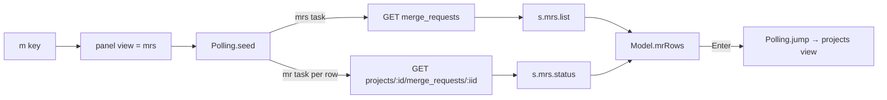

# Spec: A "my merge requests" view

The approved intent's recommendations are taken as decisions: (1) only merge
requests you opened; (2) the first 50 by `updated_at`; (3) `m` toggles the
view; (4) Enter jumps into the pipeline's project when it is in the projects
view; (5) one `head_pipeline` request per merge request, in the shared
budget; (6) the list refreshes on first switch, every 60 s while shown and on
`r`; (7) project polling continues, only the selected-project rates pause;
(8) the view is remembered until the shell restarts.

## Design

### Data flow

### Helper (`gitlab.py`)

Two new read kinds in `page_endpoint` (line 138), both page 1 only:

- **`mrs`**: `merge_requests?scope=created_by_me&state=opened&order_by=updated_at&sort=desc&per_page=50`.
  Global endpoint: it covers every project the token can see, members or not
  (GitLab "List merge requests"). Its documented fields have no pipeline.
- **`mr`**: `projects/<project>/merge_requests/<iid>`, where `project` and
  `iid` are checked with `numeric_id` (line 131). Using the numeric
  `project_id` from the list avoids parsing a path out of `references`.

New parsers, next to `pipeline()` (line 251):

- **`merge_request(row)`** → `{id, iid, project_id, project, title,
  source_branch, draft, web_url, updated_at}`. `id`, `iid` and `project_id`
  must be positive ints, or the row raises `ValueError` (like `entry`).
  `project` is `references.full` without its `!iid` suffix; if
  `project_path()` refuses it, the path of `web_url` before `/-/` is tried
  the same way; else `""`. Raw text never reaches the panel as a project.
  `title` and `source_branch` go through `plain()`
  (#15). `draft` is `bool(row.get("draft") or row.get("work_in_progress"))`.
- **`mr_detail(row)`** → `{iid, project_id, pipeline, pipelineState}`:
  - `head_pipeline` key **absent** → `pipelineState: "hidden"`, `pipeline:
    null`. GitLab exposes it only to users who may read the project's
    pipelines (`API::Entities::MergeRequest`, `if: can read_pipeline`).
  - key present and `null` → `"none"`.
  - an object → `"ok"`, `pipeline` = `pipeline(head)` plus `project_id` (the
    pipeline's own project, a positive int, which for a fork can differ from
    the merge request's `project_id`). `pipeline()` already accepts GitLab's
    basic pipeline fields (`id`, `status`, `ref`, `sha`, `source`,
    `updated_at`, `web_url`); missing `started_at` leaves `run_started_at`
    as `created_at`.

`read_page` (line 418) gains the two kinds: `mrs` returns a list plus
`total = pipeline_total(headers, len(body))` (−1 = more, count unknown);
`mr` returns an object and checks that its `iid` matches the task. A 403 or
404 on either is `errorType="permission"` with "Merge request unavailable",
not the project message.

`project()` (line 317) also returns the project's numeric `id`, so the panel
can map a pipeline's `project_id` to a catalogue path.

### Scheduler (`Polling.js`)

State in `create()`: `mrView:false`, `mrSelected:""` and `mrs:{list:null,
total:0, listAt:undefined, error:"", status:{}}`, where `status` is keyed
`"<project_id>!<iid>"` → `{state:"ok"|"none"|"hidden"|"unavailable",
pipeline, at, mrUpdated}`. `resetHost` keeps `mrView` and starts `mrs` and
`mrSelected` empty; its generation bump already drops replies for the old
host (`complete`, line 338).

**Task identity.** `ensure()` (line 58) keys on kind, repo and run only, so
repo-less tasks would collide as `mr::`. The `mr` task uses `run` =
`"<project_id>!<iid>"` (key `mr::<project_id>!<iid>`) and stores `project`
and `iid` on the task; `next()` (line 250) forwards both into the request,
as it does `status` and `route`. `mrs` is the single key `mrs::`.

- **`view(s, on, now)`** sets `mrView`, clears `wakeAt`; turning it off also
  clears `mrSelected`.
- **`seed`** (line 143), only while `opened && mrView`; every deadline that
  is not yet due goes into `wake`, like the existing tasks (lines 157, 234),
  so `next()` wakes for it even with no projects and no watches:
  - `mrs` task (group `interactive`) when `now >= age(listAt, 60000)`.
  - per listed merge request, an `mr` task with its target and group:

    | Row | Group | Due |
    | --- | --- | --- |
    | selected (`mrSelected`), unchecked | `interactive` | now |
    | selected, unfinished pipeline | `interactive` | `at + 10 s` |
    | selected, anything else | `interactive` | `at + 60 s` |
    | unchecked | `background` | now |
    | unfinished pipeline | `pinned` | `at + 30 s` |
    | finished, `none`, `hidden` or `unavailable` | `background` | `at + 10 min`, or now when the list's `updated_at` differs from `mrUpdated` |

    "Unfinished" means `pipeline.status !== "completed"`, so `manual` and
    `scheduled` head pipelines count as finished (they wait on a person or a
    clock, not a runner), as they do for project activity. `unavailable` is
    retried on the 10-minute rule and on `r`, so restored access recovers.
  - Pruning: while `mrView` is off, every `mrs` and `mr` task not in flight
    is deleted; while on, every `mr` task whose key is not in the current
    list is deleted. The owner check (line 152) does not apply: they have no
    `repo`.
- **`complete`** (line 334):
  - `mrs` replaces `list` (cut to 50), sets `total`, `listAt`, `error:""`,
    and drops statuses and queued `mr` tasks of merge requests no longer
    listed.
  - `mr`: a reply for a key no longer in the list is dropped (task deleted,
    no status written). Otherwise it stores the status with `at:now` and
    `mrUpdated` from the list row, and deletes the task.
  - Errors: `rate`, `auth`, `setup` and `network` follow the existing paths
    (cooldown, stop, backoff). `permission` on `mr` stores
    `state:"unavailable", at:now` and deletes the task; on `mrs` it sets
    `mrs.error`, `listAt=now` and deletes the task, so it retries a minute
    later. No error marks a project blocked.
  - The "invalid data" check (line 342) treats `mr` like `run` (an object).
- **`manual`** (line 117) in the merge-request view restarts the `mrs` task
  and marks every listed status due now (keeping its data until the reply),
  so `r` rechecks all rows, selected first.
- **`jump(s, repo, run, expanded, now)`**: first `select(s, repo, run,
  expanded, now, true)`, so the scheduler sees the pipeline as selected and
  expanded and `trimRuns` (line 288) keeps it even when it is older than the
  ten newest finished pipelines; then `mergeRuns` adds it, then `touch`
  (line 73) fetches it in full.
- **`select`** keeps working: in the merge-request view the panel calls it
  with no repo, so selected-project rates pause (decision 7). A new
  `selectMr(s, key)` sets `mrSelected` and clears `wakeAt`.

### Model (`PipelinesModel.js`)

- **`mrRows(mrs, filter, now, host)`** → rows with `kind:"mr"`,
  `key:"mr:<project_id>!<iid>"`, `title` `"<project> !<iid> <title>"` (with
  `Draft · ` first when draft), `subtitle` the source branch, and `status`
  from the pipeline (`state()`), or `neutral` with `info` "not checked", "no
  pipeline", "pipeline hidden" or "unavailable".
  - Age: a checked row whose status is older than its refresh target
    (10 s selected and unfinished, 30 s unfinished, 60 s selected otherwise,
    10 min otherwise) adds "checked 2m ago".
  - `url` is the merge request's `web_url` only if `browsable(url, host)`
    (line 9), else `""`, so `o` and `y` say "No link".
  - A merge request whose `project` is `""` shows "unknown project".
  - When `total` exceeds the list, or is −1, a last `kind:"more"` row says
    "N more on GitLab" or "more on GitLab". Its `url` is
    `https://<host>/dashboard/merge_requests?scope=created_by_me&state=opened`
    (built from the configured host, so `o` opens and `y` copies it); Enter
    on it does nothing but say "Open it with o".
  - Filter matches title, project, branch and status, like `runMatches`; no
    match gives "No merge requests match" in the empty state.
- `accessibleName` (line 185) covers `mr` and `more` rows.

### Panel (`PipelinesPanel.qml`)

- `property string view: "projects"` — not reset by `close()` or `open()`,
  so the panel reopens in the last view until the shell restarts.
- **`m`** toggles the view. It is handled after the help overlay and the
  action confirmation (lines 297-300, 745-749), which keep their precedence,
  and only when the list has focus (not while filtering; `m` typed in the
  search box is text).
- **Per-view state.** Each view keeps `{filter, collapsed, key}` (filter
  text, `searchCollapsed`, selected row key) in `viewState`. Assigning
  `filterText` fires `onFilterTextChanged` (line 89), which clears
  `searchCollapsed`, resets the selection and calls `selectionChanged`. So a
  switch runs in this order: save the current view's three values; set
  `switching = true` (the handler returns early while it is set); set
  `view`; assign the saved filter; restore `searchCollapsed`; set `switching
  = false`; `rebuild(false)` selecting the saved key; `selectionChanged(true)`.
- `rebuild()` (line 225) uses `Model.mrRows` in the `mrs` view;
  `selectionChanged` calls `Polling.select(s, "", "", …)` plus `selectMr` in
  that view.
- Header (line 788): `GitLab Pipelines · N projects` or `My merge requests ·
  N open`.
- Keys on an `mr` row: `o` opens and `y` copies the merge request URL; `r`
  refreshes the list and every row's status; Enter/→/l/Space jumps.
  `p t w e a c x n Y` and ←/h say "Not on a merge request; press Enter for
  its pipeline" in the footer. Navigation, `/`, `?`, `q`, Esc and zoom are
  unchanged.
- **Jump**: find the catalogue repo whose `id` is the pipeline's
  `project_id`. If found and not archived or CI-disabled: save the
  merge-request view's state, switch to the projects view as above but with
  an empty filter, add the repo and pipeline to `expanded`, call
  `Polling.jump` with that expansion, `adopt()`, then select and scroll to
  the pipeline row (`positionViewAtIndex`). Otherwise the footer says "No
  pipeline yet", "Pipeline hidden", "Not checked yet" or "Project not in
  your list; o opens the merge request".
- Empty state: "No open merge requests" when the list is empty; "Loading
  merge requests…" before the first reply; `mrs.error` uses the existing
  error strip.
- `configure()` host change: `resetHost` resets the scheduler state; the
  panel also resets both `viewState` entries (filter, collapsed, key) but
  keeps `view`, so the new host's list loads in the same view.
- `status()` adds `view` and `mrs` (count) for the smoke test.
- `listHint` gains `m MRs`; the `mrs` view has its own short hint.

### Docs

README: keyboard table (`m`, Enter on a merge-request row), a "My merge
requests" section (what is listed, the 50 cap, states, jump rules, fork
pipelines), refresh table rows (list 60 s; unfinished 30 s best effort;
finished 10 min), known limits (cap; non-member projects cannot be jumped
into; `hidden` relies on GitLab omitting the field). `keybindings.sh` gets
`m`. `manifest.json` 1.15.0.

## Alternatives rejected

- **Status from already polled pipelines (intent Q5 b)**: free, but most
  rows would stay "not checked".
- **`projects/:id/merge_requests/:iid/pipelines?per_page=1`**: its order is
  not documented, so the first item is not reliably the latest; and it
  cannot tell "hidden" from "none".
- **GraphQL** (`currentUser.authoredMergeRequests { headPipeline }`): one
  request for all rows, but a second API style, a new query path in the
  helper and different error shapes. Worth revisiting if the per-row cost
  hurts.
- **Keeping non-member projects alive for the jump**: changes discovery and
  catalogue pruning for a rare case; `o` covers it.
- **A second tree inside the merge-request view**: duplicates stage, job,
  watch, log and action rows.
- **Tab as the switch key**: it already finishes search editing.

## Risks

- **Budget**: 50 merge requests, all unchecked, cost 50 background reads on
  first switch. With nothing else due they fill in about a minute (one start
  a second). Under sustained higher-priority work the background group gets
  one slot in five (line 242), about 12 starts a minute, so filling can take
  over four minutes. `pinned` rows (unfinished pipelines) have no
  guaranteed maximum delay while `active` work stays continuously due; the
  age text shows it. The selected row always goes first.
- **`hidden` vs `none`** relies on GitLab omitting `head_pipeline` without
  read access. If a GitLab version sends `null` instead, such rows say "no
  pipeline"; only the wording is wrong.
- **Fork pipelines** in a non-member fork cannot be jumped into; the footer
  says so.
- **Panel complexity**: `PipelinesPanel.qml` is already 1,018 lines. The new
  view adds a property, a key, a switch and a jump, keeping row building in
  the model and scheduling in `Polling.js` where they are unit-tested.
- **Hosts**: p620 and razer on the 1.15.0 deploy; p510 untouched.

## Verification

- `python3 -m unittest discover -s tests`: endpoint building and validation
  for `mrs`/`mr` (bad ids refused); `merge_request` parsing (plain text,
  draft, bad project path → `""`); `mr_detail` three states and a fork
  pipeline `project_id`; `read_page` 403 → "Merge request unavailable";
  `total` −1; `project()` returns `id`.
- `node tests/polling.cjs`: nothing scheduled while `mrView` is off; list
  due at once and every 60 s; two merge requests with the same `iid` in two
  projects get two tasks and two requests carrying `project` and `iid`; with
  an empty catalogue and no watches, `wakeAt` is the next list or status
  deadline; selected unchecked row is `interactive`; unchecked rows
  `background`; unfinished rows `pinned` every 30 s, behind `active`;
  manual and scheduled head pipelines on the finished rule; finished every
  10 min and on `updated_at` change; `unavailable` retried on the 10-minute
  rule and on `manual`; list churn during a failed `mr` request deletes the
  task and drops a late reply; tasks dropped when the view turns off; `mr`
  permission → `unavailable` without blocking a repo; an old-generation
  reply is ignored after `resetHost`; `jump` keeps a pipeline older than
  the ten newest finished ones and starts its `run` task; under sustained
  `active` load background `mr` tasks still start in the one-in-five slot.
- `node tests/model.cjs`: `mrRows` titles, draft mark, states, age text for
  each refresh target, "more" row with and without a count and its URL,
  filter and no-match text, URL rejected by `browsable` on another host,
  project fallback from the URL path.
- QML smoke test, in the headless VM only:
  `nix build ./ci#checks.x86_64-linux.qml-smoke -L --override-input gltui path:<worktree>`
  with a fake helper reply for `mrs` and `mr`:
  - `m` switches, and `m` back keeps the projects cursor, filter and a
    project collapsed during search;
  - `m` typed while filtering is text; `m` during an action confirmation or
    with help open does not switch;
  - header text; no-match filter text in the merge-request view;
  - Enter jumps to the pipeline row and it is selected and visible; Enter on
    an outside project shows the footer message;
  - `p` and `a` on an `mr` row show the footer message;
  - closing and reopening keeps the view;
  - a host change during an `mr` request: old rows disappear, the old reply
    is ignored, the view stays and the new host's list loads.
- Manual on p620 after deploy: open, press `m`, check one real merge request
  and Enter into its pipeline.
